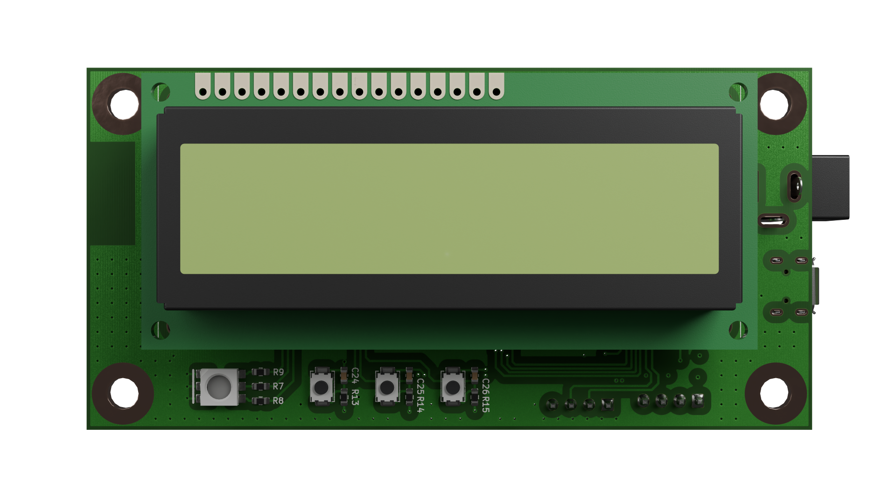

# Chronolog

  

  

## Overview

Chronolog is a temperature data logger built end to end, covering both hardware
and firmware. It records timestamped temperature readings to external flash and
shows live data on an LCD and over Wi-Fi.

📄 [View the schematic](hardware/schematic/chronolog.pdf)

## Repository Structure

- 🔌 **[hardware](hardware/):** KiCad project with schematic, PCB layout and
production files.
- 💾 **Firmware:** coming soon
